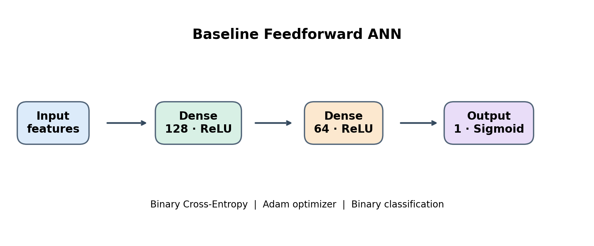
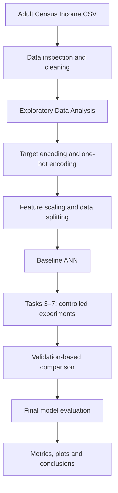
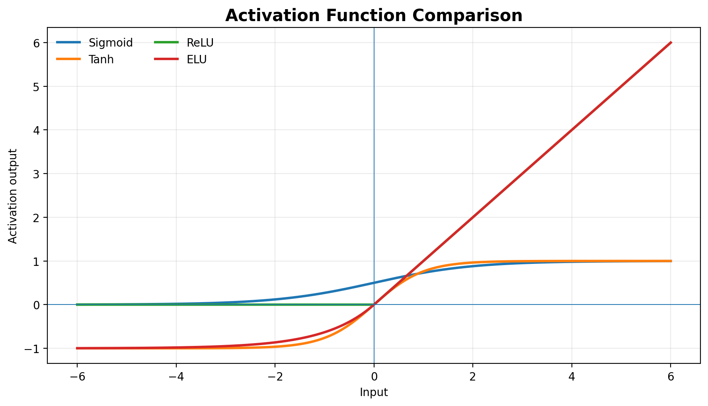

PR2 | Adult Income Classification with Artificial Neural Networks
A structured Deep Learning study of ANN architecture, activation functions, weight initialization, loss functions, batch normalization, and optimizers.

1. Project Overview
This project implements and evaluates Artificial Neural Networks (ANNs) for a binary classification problem using the Adult Census Income dataset.

The objective is to predict whether an individual's annual income is:
- Class 0: <=50K
- Class 1: >50K
Instead of building only one model, this project is organized into seven practical tasks. Each task explores a different part of the deep-learning workflow, from data preparation to optimizer comparison and final model evaluation.

Project focus: understand how ANN design choices influence training behaviour and classification performance through structured experiments.
2. Problem Definition
Item	Description
Problem type	Supervised binary classification
Dataset	Adult Census Income
Input	Demographic and employment-related attributes
Target column	income
Positive class	>50K
Negative class	<=50K
Model family	Feedforward Artificial Neural Network
Main framework	TensorFlow / Keras
Main notebook	PR2_Improved.ipynb

3. Dataset
The notebook expects a local file named adult.csv.

Dataset source: UCI Machine Learning Repository — Adult
Data preparation performed
1. Load the CSV file using Pandas.
2. Inspect dataset shape, columns, data types, and missing values.
3. Remove extra spaces from text values.
4. Replace ? markers with missing values.
5. Remove rows containing missing values.
6. Drop fnlwgt and education; retain educational-num.
7. Clean the target labels and encode >50K as 1, otherwise 0.
8. One-hot encode categorical input features.
9. Standardize numerical features.
10. Split the data using stratification for class balance.
Numerical features standardized
age, educational-num, capital-gain, capital-loss, hours-per-week
Dataset availability: adult.csv is not bundled in this README package. Download the dataset from the source above and place the CSV beside the notebook. Check the dataset's terms before redistributing it.

4. Technology Stack
Programming language
Language	Role
Python	Primary programming language used for data preparation, ANN implementation, training, evaluation, and visualization

Libraries, frameworks, and tools
Technology	Role in this project
Pandas	Data loading, cleaning, and tabular data manipulation
NumPy	Numerical operations, arrays, and custom loss calculations
Matplotlib	Training curves and experiment plots
Seaborn	Statistical visualizations and correlation heatmap
Scikit-learn	Data splitting, feature scaling, class weights, and evaluation metrics
TensorFlow	Deep-learning framework and tensor operations
Keras (tf.keras)	ANN layers, model compilation, callbacks, and optimizers
Jupyter Notebook	Interactive environment for the seven tasks
Git & GitHub	Version control and project hosting

File formats: Markdown (.md) is used for documentation, CSV (.csv) for tabular data, and Jupyter Notebook (.ipynb) for experiments. These are file/document formats, not additional programming languages used to build the model.
5. ANN Architecture
The baseline network uses two hidden Dense layers and one sigmoid output layer.

  

Layer	Configuration	Purpose
Input	Encoded feature vector	Receives preprocessed features
Hidden layer 1	128 neurons, ReLU	Learns intermediate patterns
Hidden layer 2	64 neurons, ReLU	Learns higher-level patterns
Output	1 neuron, Sigmoid	Returns probability of income >50K

Baseline configuration: Binary Cross-Entropy loss, Adam optimizer, batch size 64, and up to 50 epochs. Early stopping is used to monitor validation loss and restore the best weights.
6. End-to-End Workflow

7. Seven Tasks and Experiments
Task 1 — Data Loading, Cleaning & EDA
- Load and inspect the Adult Income dataset.
- Handle whitespace, missing-value markers, and selected columns.
- Encode the target into binary classes.
- Explore age, working hours, education number, and numerical correlations.
- Encode categorical features and standardize numerical features.
- Prepare stratified data splits for model development and evaluation.
Task 2 — Baseline Artificial Neural Network
- Build a reusable ANN model function.
- Create a feedforward network with 128 and 64 ReLU neurons.
- Use a single sigmoid output neuron.
- Compile with Adam and Binary Cross-Entropy.
- Train with batch size 64 for up to 50 epochs.
- Apply Early Stopping based on validation loss.
- Evaluate using classification metrics and a confusion matrix.
- Plot training and validation accuracy/loss.
Task 3 — Activation Function Comparison
The notebook compares four activation functions:
Activation	Key behaviour
ReLU	Zero for negative inputs; linear for positive inputs
Tanh	Output range from -1 to 1
Sigmoid	Output range from 0 to 1
ELU	Smooth negative region and linear positive region

Experiments include validation accuracy/F1 comparison, learning curves, zero-valued ReLU activation inspection, and sigmoid gradient-flow analysis.

  

The figure shows theoretical activation-function curves, not measured model-performance results.
Task 4 — Weight Initialization Techniques
Five initialization methods are evaluated:
Initializer	Description
Glorot / Xavier Uniform	Uniform initialization based on input and output dimensions
Glorot / Xavier Normal	Normal-distribution Glorot initialization
He Uniform	Uniform initialization commonly used with ReLU
He Normal	Normal-distribution He initialization
Zeros	Zero initialization experiment

The task compares convergence, validation metrics, initial and trained weights, and weight distributions. It also demonstrates why initializing every weight to zero is problematic for hidden-layer learning.
Task 5 — Loss Function Comparison
Four loss approaches are studied:
1. Binary Cross-Entropy (BCE) — standard loss for binary classification.
2. Mean Squared Error (MSE) — comparison with a loss commonly used in regression.
3. Weighted Binary Cross-Entropy — incorporates class weights calculated from training labels.
4. Focal Loss — emphasizes difficult-to-classify examples; configured with gamma=2.0 and alpha=0.25 in the notebook.
The experiments compare model behaviour and F1-score.
Task 6 — Batch Normalization
- Add Batch Normalization to hidden layers.
- Compare baseline and Batch Normalization learning curves.
- Investigate Batch Normalization placement before and after activation.
- Inspect the learned gamma and beta parameters.
- Examine moving mean and moving variance.
Task 7 — Optimizer, Convergence & Final Comparison
Five optimizer configurations are explored:
Optimizer	Configuration
SGD	Standard stochastic gradient descent
SGD + Momentum	Momentum set to 0.9
RMSprop	Adaptive learning-rate optimizer
Adam	Adaptive moment estimation
Adam (explicit)	Learning rate 0.001, beta values 0.9 and 0.999

Additional experiments compare convergence across epochs, SGD/Adam learning-rate sensitivity, validation metrics, and a final ANN evaluation using accuracy, precision, recall, F1-score, and ROC-AUC.
8. Evaluation Metrics
Metric	What it measures
Accuracy	Overall proportion of correct predictions
Precision	How many predicted >50K cases are actually >50K
Recall	How many actual >50K cases are correctly identified
F1-score	Balance between precision and recall
ROC-AUC	Ability to distinguish between the two income classes
Confusion Matrix	Correct and incorrect predictions for each class

Because income classes may be imbalanced, accuracy should not be interpreted alone. Precision, recall, F1-score, and ROC-AUC provide a more complete evaluation.
Experiment Results
Populate this table with the actual outputs from your completed notebook run. No estimated scores are presented as experimental results.
Experiment	Validation Accuracy	Precision	Recall	F1-score	ROC-AUC
Baseline ANN	—	—	—	—	—
Activation comparison winner	—	—	—	—	—
Initialization comparison winner	—	—	—	—	—
Loss comparison winner	—	—	—	—	—
Batch Normalization ANN	—	—	—	—	—
Final ANN	—	—	—	—	—

9. Visualizations Generated by the Notebook
Task	Visual analysis
Task 1	Age distribution, working-hours boxplot, education count plot, correlation heatmap
Task 2	Training/validation accuracy and loss, confusion matrix
Task 3	Activation learning curves, ReLU activation analysis, sigmoid gradient analysis
Task 4	Initializer convergence, zero-initialization behaviour, weight distributions
Task 5	Loss comparison and F1-score comparison
Task 6	Baseline vs BatchNorm curves, BatchNorm placement, gamma/beta analysis
Task 7	Optimizer convergence, learning-rate sensitivity, final evaluation plots

To showcase the measured experiments on GitHub, save the notebook's actual output plots into assets/ and embed them in this section. The two included figures are explanatory diagrams, not measured experiment results.
10. Installation & Execution
Step 1 — Clone the repository
git clone <YOUR_REPOSITORY_URL>
cd <YOUR_PROJECT_FOLDER>
Step 2 — Create a virtual environment (recommended)
Windows PowerShell:
python -m venv .venv
.venv\Scripts\Activate.ps1
Step 3 — Install dependencies
python -m pip install --upgrade pip
python -m pip install pandas numpy matplotlib seaborn scikit-learn tensorflow jupyter
Step 4 — Add the dataset
Place adult.csv in the same directory as PR2_Improved.ipynb.
Step 5 — Start Jupyter Notebook
jupyter notebook
Open PR2_Improved.ipynb and execute the cells from top to bottom. Later tasks depend on variables and models created earlier.
11. Repository Structure
PR2-Adult-Income-ANN/
│
├── PR2_Improved.ipynb
├── adult.csv
├── README.md
│
└── assets/
    ├── ann_architecture.png
    └── activation_functions.png
If dataset redistribution is not permitted, do not commit adult.csv to a public repository. Include dataset download instructions instead.
12. Key Learning Outcomes
By completing this project, the following concepts are practiced:
- Data cleaning and exploratory data analysis.
- Encoding categorical features and scaling numerical features.
- Designing and training feedforward neural networks.
- Understanding activation functions and gradient flow.
- Comparing weight initialization strategies.
- Understanding loss functions and class imbalance.
- Applying Batch Normalization.
- Comparing optimizers and learning-rate behaviour.
- Evaluating binary classifiers with multiple metrics.
- Communicating model experiments through tables and plots.
13. Future Improvements
- Use a preprocessing pipeline with imputers instead of dropping every row containing missing data.
- Tune the classification threshold using validation data.
- Repeat experiments with multiple random seeds and report mean and standard deviation.
- Add systematic hyperparameter tuning with Keras Tuner.
- Save the final model and preprocessing objects for reproducible inference.
- Build a Streamlit interface for interactive predictions.
- Explore model explainability with permutation importance or SHAP.
14. Reproducibility & Evaluation Notes
Before publishing final model scores, verify the following:
1. Prevent data leakage: fit the scaler only on training data; apply the fitted scaler to validation and test data.
2. Use the correct evaluation split: generate final test predictions from X_test and compare them with y_test.
3. Select models using validation data: keep the test set for final evaluation only.
4. Compare experiments fairly: keep data splits and training settings consistent.
5. Report measured values only: fill the results table from the executed notebook, not estimated values.
15. Author
Manan Patel
- GitHub: @pmanan2031-web

Built with Python · TensorFlow · Keras · Scikit-learn

Learn the fundamentals. Experiment with purpose. Evaluate with evidence.

