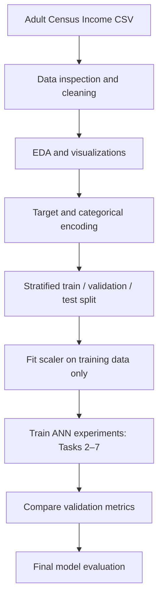

  
  <h1>PR2 — Adult Income Classification using Artificial Neural Network</h1>
  
<strong>A hands-on Deep Learning project exploring ANN architecture, activation functions, weight initialization, loss functions, batch normalization, and optimizers.</strong>

  

    
    
    
    
    
  

📌 Project Overview
This project builds and studies an Artificial Neural Network (ANN) for binary classification using the Adult Census Income dataset. The objective is to predict whether a person's annual income is greater than $50K or $50K or less, based on demographic and work-related attributes.

Rather than training only one neural network, this project compares important Deep Learning choices across seven structured tasks. It examines how data preparation, activation functions, weight initialization, loss functions, batch normalization, and optimizers affect model learning and classification performance.
Project focus: understand the behaviour of ANN components through controlled experiments and compare models using validation metrics.

🎯 Problem Statement
Given a person's attributes (for example age, education, occupation, workclass, and hours worked per week), classify the income category:
Encoded target	Meaning
0	Income <=50K
1	Income >50K

This is a supervised binary classification problem.
🗂️ Dataset
- Dataset: Adult Census Income (also known as the Adult dataset)
- Local file expected by the notebook: adult.csv
- Target column: income
- Target preparation: removes a trailing period from labels and maps >50K to 1; other income labels become 0.
- Dataset reference: UCI Machine Learning Repository — Adult
The notebook strips whitespace from text columns, converts ? markers to missing values, drops rows with missing values, and removes fnlwgt and education before modelling. It retains educational-num as the numeric education representation.

Important: obtain the dataset from the linked source and place the correctly named adult.csv in the same directory as the notebook. The README does not include the dataset.
🧠 Project Workflow

📚 Seven Tasks Covered
Task 1 — Data Loading, Cleaning & Exploratory Data Analysis
- Load adult.csv with Pandas and inspect rows, dimensions, and data types.
- Strip extra spaces from categorical values.
- Replace ? with missing values and remove rows containing missing data.
- Drop fnlwgt and education columns.
- Encode the income target as a binary label.
- Explore the data using:
  - Age distribution by income (histogram / KDE)
  - Hours-per-week by income (box plot)
  - Education number by income (count plot)
  - Numeric correlation heatmap
- One-hot encode categorical predictors.
- Split data with stratification into training, validation, and test sets.
- Standardize the numeric columns. The scaler is fitted on training data and then applied to validation and test data.
Task 2 — Baseline Artificial Neural Network
A reusable ANN builder creates a feed-forward network with:
Layer	Configuration
Input	Number of encoded input features
Hidden layer 1	128 neurons, ReLU, Glorot Uniform initialization
Hidden layer 2	64 neurons, ReLU, Glorot Uniform initialization
Output	1 neuron, Sigmoid activation

- Loss: Binary Cross-Entropy
- Default optimizer: Adam
- Batch size: 64
- Maximum training epochs: 50
- Early stopping monitors validation loss and restores the best weights.
- Training/validation accuracy and loss curves are plotted.
- Classification is assessed using accuracy, precision, recall, F1-score, confusion matrix, and classification report.
Task 3 — Activation Function Comparison
The notebook compares four hidden-layer activation functions:
- ReLU
- Tanh
- Sigmoid
- ELU
It compares validation accuracy and F1-score, plots learning curves, checks zero-valued ReLU activations, and inspects gradient flow through sigmoid hidden layers.
Task 4 — Weight Initialization Techniques
Five initializers are compared with the same ANN structure:
- Glorot / Xavier Uniform (glorot_uniform)
- Glorot / Xavier Normal (glorot_normal)
- He Uniform (he_uniform)
- He Normal (he_normal)
- Zeros (zeros)
The notebook records initial and trained weights, compares convergence behaviour, demonstrates the limitation of zero initialization, and visualizes weight distributions.
Task 5 — Loss Function Comparison
The project studies four loss approaches:
1. Binary Cross-Entropy (BCE)
2. Mean Squared Error (MSE)
3. Weighted Binary Cross-Entropy using class weights calculated from the training labels
4. Focal Loss with configurable gamma and alpha (the notebook uses gamma=2.0 and alpha=0.25)
The goal is to understand standard binary classification loss and approaches that can place more emphasis on difficult examples or class imbalance.
Task 6 — Batch Normalization
- Build an ANN with Batch Normalization in its hidden layers.
- Compare training and validation curves with the baseline model.
- Compare Batch Normalization placement before and after activation.
- Inspect learned Batch Normalization parameters (gamma and beta).
Task 7 — Optimizer, Convergence & Final Comparison
Five optimizer configurations are explored:
- SGD
- SGD with Momentum
- RMSprop
- Adam
- Adam with explicitly specified parameters
Additional experiments compare learning-rate sensitivity for SGD and Adam. The notebook combines selected ANN techniques and compares candidate models using validation accuracy, precision, recall, F1-score, and ROC-AUC, with ROC curve visualization.
🛠️ Technology Stack & Languages Used
Programming language
- Python — the primary and only programming language used for data preparation, model building, training, evaluation, and plotting.
Libraries and frameworks
Tool / Library	How it is used
Pandas	Read CSV data, clean columns, encode/organize data, and create result tables
NumPy	Numerical operations, arrays, and custom loss calculations
Matplotlib	Plot training curves, distributions, and model comparisons
Seaborn	Statistical plots and correlation heatmap
Scikit-learn	Train/validation/test splitting, scaling, class weights, and evaluation metrics
TensorFlow	Deep Learning backend and tensor operations
Keras (tf.keras)	ANN architecture, layers, callbacks, optimizers, and model training
Jupyter Notebook	Interactive environment used to organize the seven practical tasks

Other file/markup formats: Markdown is used for this README; CSV is used for the dataset; .ipynb is the Jupyter Notebook file format. These are not additional programming languages used to implement the model.
📊 Evaluation Metrics
The experiments use the following classification metrics:
- Accuracy: overall fraction of correct predictions.
- Precision: among predicted >50K cases, how many are correct.
- Recall: among actual >50K cases, how many are found.
- F1-score: harmonic mean of precision and recall.
- ROC-AUC: how well predicted probabilities separate the two income classes.
- Confusion matrix: counts of correct and incorrect predictions for each class.
No fixed accuracy or “best model” score is claimed in this README because notebook outputs depend on the dataset file, installed library versions, and actual execution. Run all cells and add your measured results to the table below before publishing.
Results (fill after running the notebook)
Model / Experiment	Validation Accuracy	Precision (class 1)	Recall (class 1)	F1 (class 1)	ROC-AUC
Baseline ANN	—	—	—	—	—
Best activation	—	—	—	—	—
Best initializer	—	—	—	—	—
Weighted BCE	—	—	—	—	—
Focal Loss	—	—	—	—	—
Batch Normalization	—	—	—	—	—
Final Combined ANN	—	—	—	—	—

⚙️ Installation & Setup
1. Clone or download the project
git clone <YOUR_GITHUB_REPOSITORY_URL>
cd <YOUR_PROJECT_FOLDER>
If the project is not on GitHub yet, download the notebook and README into one folder instead.
2. Create and activate a virtual environment (recommended)
Windows PowerShell:
python -m venv .venv
.venv\Scripts\Activate.ps1
3. Install dependencies
python -m pip install --upgrade pip
python -m pip install pandas numpy matplotlib seaborn scikit-learn tensorflow jupyter
4. Add the dataset
Place adult.csv next to PR2_Improved.ipynb.
5. Launch Jupyter Notebook
jupyter notebook
Open PR2_Improved.ipynb and run the cells from top to bottom. The experiments in later tasks depend on variables and models created in earlier tasks.
📁 Suggested Repository Structure
PR2-Adult-Income-ANN/
│
├── PR2_Improved.ipynb       # Main notebook containing Tasks 1–7
├── adult.csv                # Dataset (download separately; do not commit if restricted)
├── README.md                # Project documentation
└── assets/
    └── pr2_banner.png       # Project banner image
🔍 Key Learning Outcomes
After completing this project, you can explain and demonstrate:
- How to prepare mixed numerical and categorical tabular data for an ANN.
- Why the scaler must be fitted only on training data.
- How activation functions affect learning and gradient flow.
- Why weight initialization matters for neural network training.
- How BCE, MSE, weighted BCE, and Focal Loss differ.
- How Batch Normalization works and where it can be placed.
- How optimizers and learning rates affect convergence.
- Why validation metrics should guide model selection and the test set should be reserved for final evaluation.
🚀 Future Improvements
- Add a clean, reusable preprocessing pipeline with imputers rather than dropping every row with missing values.
- Tune the decision threshold using validation data and compare precision-recall trade-offs.
- Run experiments across multiple random seeds and report mean and standard deviation.
- Add hyperparameter tuning (for example Keras Tuner or scikit-learn search tools).
- Save the final trained model and preprocessing objects for reproducible inference.
- Build a small Streamlit interface for interactive income-category predictions.
- Add explainability methods such as permutation importance or SHAP where appropriate.
⚠️ Final Evaluation Check Before Publishing
In the current notebook, the final prediction block creates predictions from X_val but then compares them with y_test. These arrays represent different splits and may have different lengths. Before reporting test metrics, generate the final probabilities from X_test and compare them with y_test. Keep validation data for model selection and use the test set only once for final evaluation.
👨‍💻 Author
Manan Patel
GitHub: pmanan2031-web

  
<strong>Built to learn. Experimented to understand. Evaluated with care.</strong>

  PR2 — Artificial Neural Network | Adult Census Income Classification

