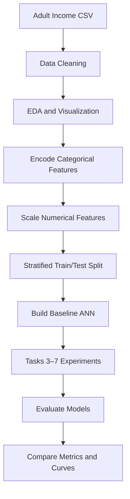

PR2 — Artificial Neural Network for Adult Income Classification
Deep Learning Project | Binary Classification | Adult Income Dataset

This repository contains a seven-task practical study of Artificial Neural Networks (ANNs) for predicting whether an individual's annual income is greater than $50K or $50K or less, using demographic and employment-related attributes from the Adult Income dataset.

The notebook focuses on how data preparation, network design, activation functions, weight initialization, loss functions, batch normalization, and optimizers affect ANN training and evaluation.
Table of Contents
- Project Overview
- Problem Statement
- Dataset
- Technologies and Libraries
- ANN Architecture
- Project Workflow
- Seven Tasks Covered
- Graphs and Visual Analysis
- Evaluation Metrics
- How to Run the Project
- Project Structure
- Important Implementation Notes
- Learning Outcomes
- Future Improvements
- Author
📌 Project Overview
An Artificial Neural Network (ANN) is a deep learning model inspired by the way biological neurons process information. In this project, a feedforward ANN is trained on tabular data to perform a binary classification task.

The project is organized into seven tasks, moving from data understanding and preprocessing to model experimentation and optimizer comparison.
Item	Details
Project	PR2 — Artificial Neural Network
Domain	Machine Learning / Deep Learning
Problem type	Binary classification
Dataset	Adult Income Dataset (adult.csv)
Target column	income
Target classes	<=50K and >50K
Main model	Feedforward ANN
Baseline hidden layers	128 and 64 neurons
Baseline hidden activation	ReLU
Baseline output activation	Sigmoid
Baseline loss	Binary Cross-Entropy
Baseline optimizer	Adam
Notebook	PR2.ipynb

🎯 Problem Statement
The objective is to build a neural network that learns patterns from input attributes and predicts the income category:
- Class 0: Income is <=50K
- Class 1: Income is >50K
This is supervised learning because the dataset contains input features along with known target labels.
📂 Dataset
The notebook reads the dataset from a local CSV file:
df = pd.read_csv("adult.csv")
The target column is income. The notebook removes whitespace, replaces ? with missing values, drops rows containing missing values, and removes the fnlwgt and education columns before modeling.
Data preparation performed
1. Load adult.csv using Pandas.
2. Strip leading and trailing spaces from text columns.
3. Replace ? with NaN.
4. Remove rows with missing values.
5. Drop fnlwgt and education.
6. Remove a trailing period from income labels, when present.
7. Convert the target to binary values (>50K = 1, otherwise 0).
8. One-hot encode categorical input columns.
9. Standardize selected numerical columns.
10. Split the data into training and testing sets using an 80:20 split, random_state=42, and stratification.
Numerical columns standardized
- age
- educational-num
- capital-gain
- capital-loss
- hours-per-week
Dataset note: The CSV is not included in this README. Add your permitted copy of adult.csv to the project folder before running the notebook. Final row and feature counts depend on the exact CSV version and rows removed during cleaning.

🛠️ Technologies and Libraries
Programming languages
Language	Use
Python	Main language for data processing, model building, training, and evaluation
Markdown	Project documentation

Libraries and tools
Library / Tool	Purpose
Pandas	Loading, cleaning, and manipulating tabular data
NumPy	Numerical operations and array handling
Matplotlib	Training curves and plots
Seaborn	EDA plots and correlation heatmap
Scikit-learn	Train/test split, scaling, class weights, and evaluation metrics
TensorFlow	Deep learning framework
Keras (tf.keras)	Building, compiling, and training ANN models
Jupyter Notebook	Interactive implementation

Install dependencies:
pip install pandas numpy matplotlib seaborn scikit-learn tensorflow jupyter
🧠 ANN Architecture
The baseline ANN uses two hidden layers and one output layer.

Layer	Configuration	Purpose
Input	Encoded input features	Receives preprocessed data
Hidden layer 1	128 neurons, ReLU	Learns first-level patterns
Hidden layer 2	64 neurons, ReLU	Learns higher-level patterns
Output layer	1 neuron, Sigmoid	Produces probability for the >50K class

The baseline model uses Adam and Binary Cross-Entropy. The classification threshold in the notebook is 0.5.
🔄 Project Workflow

📚 Seven Tasks Covered
Task 1 — Data Loading, Cleaning and EDA
- Load the Adult Income CSV.
- Inspect rows, data types, and missing values.
- Clean text fields and handle missing values.
- Remove selected columns.
- Convert income labels into binary values.
- Visualize age distribution, working hours, education number, and numeric correlations.
- Encode categorical features and scale selected numerical features.
- Create a stratified train/test split.
Task 2 — Baseline ANN
- Create a reusable ANN-building function.
- Build a network with hidden layers of 128 and 64 neurons.
- Use ReLU in hidden layers and Sigmoid in the output layer.
- Compile with Adam and Binary Cross-Entropy.
- Train for up to 50 epochs with batch size 64 and a 10% validation split.
- Evaluate using accuracy, precision, recall, F1-score, classification report, and confusion matrix.
- Plot training and validation accuracy/loss.
Task 3 — Activation Function Comparison
The notebook compares four activation functions:
Activation	Main characteristic
ReLU	Zero for negative inputs; linear for positive inputs
Tanh	Outputs values between -1 and 1
Sigmoid	Outputs values between 0 and 1
ELU	Smooth negative region and linear positive region

Additional experiments:
- Compare training and validation accuracy.
- Compare F1-scores.
- Inspect ReLU hidden-layer activations for zero-valued outputs.
- Inspect gradient magnitudes in the Sigmoid model.

This graph shows the mathematical shapes of the activation functions; it is not a plot of measured model performance.
Task 4 — Weight Initialization
Five initializers are compared:
Initializer	Purpose
glorot_uniform	Glorot/Xavier uniform initialization
glorot_normal	Glorot/Xavier normal initialization
he_uniform	He uniform initialization
he_normal	He normal initialization
zeros	Zero initialization experiment

The notebook stores initial and trained weights, compares validation accuracy and F1-score, examines convergence curves, demonstrates zero-initialization behavior, and visualizes weight distributions before and after training.
Task 5 — Loss Function Comparison
Four loss approaches are explored:
Loss	Project use
Binary Cross-Entropy (BCE)	Baseline binary classification loss
Mean Squared Error (MSE)	Comparison with a regression-oriented loss
Weighted BCE	Uses class weights to account for class imbalance
Focal Loss	Gives more emphasis to harder examples

The notebook compares F1-scores and identifies the best-performing loss according to that metric.
Task 6 — Batch Normalization
This task investigates how Batch Normalization affects neural network training.

Experiments include:
- Build and train an ANN with Batch Normalization.
- Compare baseline and Batch Normalization validation loss and accuracy.
- Compare Batch Normalization placement relative to activation.
- Inspect learned gamma and beta parameters.
- Visualize learned scaling and shifting parameters.
- Review moving mean and moving variance.
Task 7 — Optimizer Comparison and Final ANN
The notebook compares five optimizer configurations:
Optimizer	Configuration
SGD	Standard stochastic gradient descent
SGD Momentum	SGD with momentum = 0.9
RMSprop	Adaptive learning-rate optimizer
Adam	Adam optimizer
Adam Explicit	Adam with learning rate 0.001, beta1 0.9, beta2 0.999

Further experiments:
- Compare validation accuracy across 50 epochs.
- Record the first epoch crossing the 83% validation-accuracy reference, if reached.
- Compare final test accuracy and F1-score.
- Compare SGD and Adam learning-rate sensitivity.
- Train a final combined ANN and calculate accuracy, precision, recall, F1-score, and ROC-AUC.
- Plot final training and validation curves.
The notebook's measured scores are generated when it is executed. No fixed accuracy or “best optimizer” result is claimed here because values depend on the actual run.

📊 Graphs and Visual Analysis
The notebook generates these experiment plots when its cells are run:
Task	Graphs / Visualizations
Task 1	Age distribution, working-hours boxplot, education countplot, correlation heatmap
Task 2	Training/validation accuracy and loss, confusion matrix
Task 3	Activation comparison curves, ReLU activation distribution, gradient magnitude
Task 4	Initializer convergence, zero-initialization behavior, weight distributions
Task 5	Loss comparison curves and F1-score summary
Task 6	Baseline vs BatchNorm curves, BatchNorm position, gamma and beta plots
Task 7	Optimizer convergence, learning-rate sensitivity, final ANN accuracy/loss

To include your actual experiment graphs in this README, save the plots from the executed notebook into assets/ and link them here. Do not substitute illustrative curves for measured results.
📏 Evaluation Metrics
Metric	Meaning
Accuracy	Overall fraction of correct predictions
Precision	Fraction of predicted positive cases that are actually positive
Recall	Fraction of actual positive cases correctly identified
F1-score	Harmonic mean of precision and recall
ROC-AUC	Measures how well the model separates the two classes
Confusion Matrix	Shows correct and incorrect predictions for each class

For an imbalanced dataset, accuracy alone may be misleading. Precision, recall, F1-score, and ROC-AUC provide additional information.
▶️ How to Run the Project
1. Clone the repository
git clone https://github.com/pmanan2031-web/PR2-ANN.git
cd PR2-ANN
2. Create and activate a virtual environment (recommended)
Windows PowerShell:
python -m venv venv
.\venv\Scripts\Activate.ps1
3. Install dependencies
pip install pandas numpy matplotlib seaborn scikit-learn tensorflow jupyter
4. Add the dataset
Ensure adult.csv is in the same folder as PR2.ipynb.
5. Launch Jupyter Notebook
jupyter notebook
Open PR2.ipynb and run the cells in order.
Training multiple ANN experiments can take time. Use a TensorFlow-compatible Python environment and verify the TensorFlow installation if import fails.

📁 Project Structure
PR2-ANN/
│
├── PR2.ipynb
├── adult.csv
├── README.md
│
└── assets/
    ├── ann_architecture.png
    └── activation_functions.png
If you do not have permission to redistribute the dataset, do not upload adult.csv to a public repository; document where it can be obtained instead.
⚠️ Important Implementation Notes
Before presenting final scores as portfolio results, review these points in the notebook:
1. Avoid data leakage: Task 1 currently fits StandardScaler before the train/test split. For a leakage-safe workflow, split first, fit the scaler only on X_train, and use transform() on validation/test data.
2. Keep final evaluation consistent: Generate final predictions from X_test and compare them with y_test. Do not compare validation predictions with test labels.
3. Final loss selection: Task 7 checks whether Weighted BCE improves F1, but the final model builder is called with Binary Cross-Entropy. If you intend to select the loss dynamically, pass the selected loss into the final model and verify the class-weight logic.
4. Fair comparisons: Use the same data split and comparable training settings across experiments. For stronger conclusions, repeat experiments with multiple random seeds.
5. Report real outputs: Copy accuracy, precision, recall, F1-score, ROC-AUC, and confusion-matrix values from a completed run. Do not use estimated or illustrative metrics.
🎓 Learning Outcomes
By completing this project, you practice:
- Data cleaning and exploratory data analysis.
- Encoding categorical variables and scaling numerical features.
- Building a feedforward ANN using Keras.
- Understanding activation functions and gradient behavior.
- Comparing weight initialization techniques.
- Understanding loss functions for binary classification and class imbalance.
- Applying Batch Normalization.
- Comparing optimizers and learning rates.
- Evaluating classification models using multiple metrics.
- Communicating experiments with tables and visualizations.
🚀 Future Improvements
- Add dropout and L1/L2 regularization experiments.
- Apply early stopping and learning-rate scheduling.
- Tune hyperparameters with Keras Tuner or randomized search.
- Compare ANN performance with Logistic Regression, Random Forest, and Gradient Boosting.
- Add threshold tuning and precision-recall curve analysis.
- Save the trained model and build a Streamlit prediction interface.
- Add automated tests and a reproducible requirements file.
👨‍💻 Author
Manan Patel
- GitHub: pmanan2031-web
⭐ If you find this project useful, consider giving the repository a star.

Built with Python, TensorFlow, Keras, and a continuous learning mindset.
