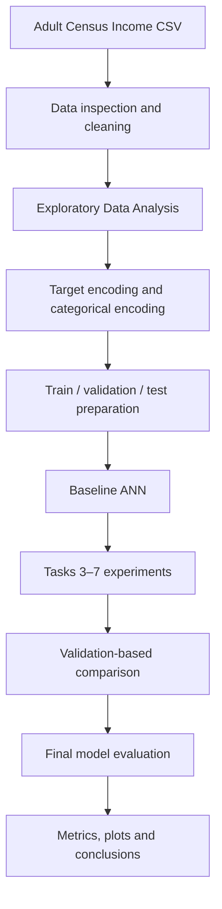

<div align="center">

# Adult Income Classification using Artificial Neural Networks

### A Seven-Task Deep Learning Experimentation Project

[](https://www.python.org/)
[](https://www.tensorflow.org/)
[](https://keras.io/)
[](https://scikit-learn.org/)
[](https://jupyter.org/)
[](#)

**Python · TensorFlow · Keras · Scikit-learn · Deep Learning**

</div>

---

## Overview

This project builds and evaluates an **Artificial Neural Network (ANN)** for the **Adult Census Income Classification** problem. The model learns from demographic and employment-related attributes and predicts whether an individual's income is **above $50K** or **$50K or below**.

The notebook is designed as a practical, seven-task deep-learning study. It starts with data cleaning and exploratory analysis, then moves through baseline ANN development, activation functions, weight initialization, loss functions, batch normalization, and optimizer comparison.

The focus is not only to train a classifier, but also to understand how neural-network design and training choices affect learning behaviour and evaluation.

## Project Highlights

- Seven clearly organized tasks, preserving the original practical workflow.
- End-to-end tabular data preparation and exploratory data analysis.
- Baseline feedforward ANN built with TensorFlow/Keras.
- Comparison of four activation functions.
- Evaluation of five weight initialization techniques.
- Comparison of four loss-function approaches.
- Batch Normalization experiments and parameter inspection.
- Comparison of five optimizer configurations.
- Classification metrics, confusion matrix, and training curves.
- Reproducible notebook workflow with a fixed random seed where configured.

## Problem Statement

The objective is a supervised **binary classification** task.

| Target label | Meaning | Encoded value |
|---|---|---:|
| `<=50K` | Income is $50,000 or less | 0 |
| `>50K` | Income is greater than $50,000 | 1 |

Given the input attributes, the neural network estimates the probability that a person belongs to the `>50K` income class.

## Dataset

**Dataset:** Adult Census Income Dataset  
**Target column:** `income`  
**Input file expected by the notebook:** `adult.csv`

The dataset contains demographic, education, work, and other census-related attributes.

**Dataset reference:** [UCI Machine Learning Repository — Adult](https://archive.ics.uci.edu/dataset/2/adult)

> The dataset file is not included in this README package. Download an authorized copy and place `adult.csv` in the same directory as the notebook. Check the dataset's terms before redistributing it.

### Data preparation

The notebook's data-preparation workflow includes:

1. Loading the CSV file with Pandas.
2. Inspecting dataset dimensions, columns, data types, and missing values.
3. Removing leading/trailing spaces from text values.
4. Replacing `?` markers with missing values and handling missing rows.
5. Removing the `fnlwgt` and `education` columns while retaining `educational-num`.
6. Cleaning and binary-encoding the income target.
7. One-hot encoding categorical predictors.
8. Standardizing numerical predictors.
9. Preparing stratified data partitions for model development and evaluation.

Numerical columns used for scaling:

`age`, `educational-num`, `capital-gain`, `capital-loss`, `hours-per-week`

## Technology Stack

| Category | Technology | Usage |
|---|---|---|
| Programming language | **Python** | Complete data science and deep-learning implementation |
| Data manipulation | Pandas | Loading, cleaning, and transforming tabular data |
| Numerical computing | NumPy | Arrays and mathematical operations |
| Visualization | Matplotlib | Charts and training curves |
| Visualization | Seaborn | Statistical plots and heatmaps |
| Machine learning utilities | Scikit-learn | Data splitting, scaling, class weights, and metrics |
| Deep-learning framework | TensorFlow | Neural-network computation and training |
| Neural-network API | Keras (`tf.keras`) | ANN layers, model compilation, callbacks, and optimizers |
| Development environment | Jupyter Notebook | Executing and documenting the seven tasks |
| Documentation | Markdown | Project documentation |

**Language clarification:** Python is the programming language used to implement the project. Markdown is used to write this README. TensorFlow, Keras, Pandas, NumPy, and Scikit-learn are libraries/frameworks, not programming languages.

## Model Architecture

The baseline model is a feedforward neural network with two hidden Dense layers and a single sigmoid output.

<p align="center">
  
</p>

| Layer | Configuration | Role |
|---|---|---|
| Input | Encoded feature vector | Receives prepared input features |
| Hidden layer 1 | 128 neurons, ReLU | Learns intermediate patterns |
| Hidden layer 2 | 64 neurons, ReLU | Learns higher-level patterns |
| Output layer | 1 neuron, Sigmoid | Predicts probability of income `>50K` |

**Baseline training setup**

| Parameter | Configuration |
|---|---|
| Loss function | Binary Cross-Entropy |
| Optimizer | Adam |
| Batch size | 64 |
| Maximum epochs | 50 |
| Output threshold | 0.5 |
| Training control | Early Stopping on validation loss |

## Project Workflow



## Seven Tasks Implemented

### Task 1 — Data Loading, Cleaning and Exploratory Data Analysis

- Load and inspect the Adult Income dataset.
- Handle whitespace and missing-value markers.
- Remove selected columns and prepare the target variable.
- Explore age, working hours, education number, and numerical correlations.
- Encode categorical variables and scale numerical features.
- Prepare stratified data partitions for model development and evaluation.

**EDA visualizations:** age distribution by income, working-hours boxplot, education count plot, and numerical correlation heatmap.

### Task 2 — Baseline Artificial Neural Network

- Create a reusable ANN model-building function.
- Build hidden layers with 128 and 64 ReLU neurons.
- Add one sigmoid output neuron for binary classification.
- Compile using Adam and Binary Cross-Entropy.
- Train with batch size 64 for up to 50 epochs.
- Apply Early Stopping to monitor validation loss and restore the best weights.
- Evaluate using accuracy, precision, recall, F1-score, classification report, and confusion matrix.
- Plot training and validation accuracy/loss.

### Task 3 — Activation Function Comparison

Four hidden-layer activation functions are compared:

| Activation | Key behaviour |
|---|---|
| ReLU | Zero for negative values; linear for positive values |
| Tanh | Output range from -1 to 1 |
| Sigmoid | Output range from 0 to 1 |
| ELU | Smooth negative region and linear positive region |

The task compares validation accuracy and F1-score, examines learning curves, checks zero-valued ReLU activations, and investigates gradient flow in sigmoid networks.

<p align="center">
  
</p>

*This is a mathematical illustration of activation functions, not a measured model-performance chart.*

### Task 4 — Weight Initialization Techniques

The following initialization methods are examined:

- Glorot/Xavier Uniform (`glorot_uniform`)
- Glorot/Xavier Normal (`glorot_normal`)
- He Uniform (`he_uniform`)
- He Normal (`he_normal`)
- Zero Initialization (`zeros`)

The experiments compare convergence behaviour, validation metrics, initial and trained weights, and weight distributions. The zero-initialization experiment demonstrates why identical starting weights can prevent hidden neurons from learning different features.

### Task 5 — Loss Function Comparison

Four loss approaches are studied:

| Loss function | Purpose |
|---|---|
| Binary Cross-Entropy | Standard loss for binary classification |
| Mean Squared Error | Comparison with a regression-oriented loss |
| Weighted Binary Cross-Entropy | Accounts for class imbalance using class weights |
| Focal Loss | Places greater emphasis on difficult examples |

The notebook compares model behaviour and F1-score across the loss experiments.

### Task 6 — Batch Normalization

- Add Batch Normalization to the ANN.
- Compare baseline and Batch Normalization training/validation curves.
- Examine Batch Normalization placement relative to activation.
- Inspect learned `gamma` and `beta` parameters.
- Review moving mean and moving variance.

### Task 7 — Optimizer Comparison and Final ANN

Five optimizer configurations are compared:

| Optimizer | Configuration |
|---|---|
| SGD | Standard stochastic gradient descent |
| SGD + Momentum | Momentum = 0.9 |
| RMSprop | Adaptive learning-rate optimizer |
| Adam | Adaptive moment estimation |
| Adam (explicit) | Learning rate = 0.001, beta1 = 0.9, beta2 = 0.999 |

The task compares convergence, validation performance, learning-rate sensitivity, and final classification metrics. The final ANN is assessed using accuracy, precision, recall, F1-score, and ROC-AUC.

## Model Evaluation

The project uses multiple classification metrics rather than relying only on accuracy.

| Metric | Interpretation |
|---|---|
| Accuracy | Overall proportion of correct predictions |
| Precision | Correct positive predictions among all predicted positives |
| Recall | Correctly identified positive cases among all actual positives |
| F1-score | Harmonic mean of precision and recall |
| ROC-AUC | Ability to distinguish between the two income classes |
| Confusion Matrix | Breakdown of correct and incorrect predictions |

### Experiment comparison

Fill this table with values produced by running the notebook. No performance figures are fabricated.

| Experiment | Validation Accuracy | F1-score | Notes |
|---|---:|---:|---|
| Baseline ANN | — | — | Reference model |
| Activation comparison | — | — | Best activation by validation metric |
| Weight initialization | — | — | Best initializer by validation metric |
| Loss comparison | — | — | Best loss by validation metric |
| Batch Normalization | — | — | Compare with baseline |
| Optimizer comparison | — | — | Best optimizer by validation metric |
| Final ANN | — | — | Report final held-out test metrics separately |

## Visual Analysis

The notebook produces experiment-specific visualizations:

| Task | Visualizations |
|---|---|
| 1 | Age distribution, working-hours boxplot, education count plot, correlation heatmap |
| 2 | Training/validation accuracy and loss, confusion matrix |
| 3 | Activation curves, ReLU activation analysis, sigmoid gradient analysis |
| 4 | Initializer convergence and weight distributions |
| 5 | Loss comparison and F1-score comparison |
| 6 | Batch Normalization learning curves, placement, gamma/beta analysis |
| 7 | Optimizer convergence, learning-rate sensitivity, final evaluation plots |

The two images included in this repository are explanatory figures. Save the actual notebook output plots into `assets/` to showcase measured experiment results.

## Installation and Execution

### 1. Clone the repository

```bash
git clone <YOUR_REPOSITORY_URL>
cd <YOUR_PROJECT_FOLDER>
```

### 2. Create a virtual environment

**Windows PowerShell**

```powershell
python -m venv .venv
.venv\Scripts\Activate.ps1
```

### 3. Install dependencies

```bash
python -m pip install --upgrade pip
python -m pip install pandas numpy matplotlib seaborn scikit-learn tensorflow jupyter
```

### 4. Add the dataset

Place `adult.csv` in the same directory as `PR2_Improved.ipynb`.

### 5. Launch Jupyter Notebook

```bash
jupyter notebook
```

Open `PR2_Improved.ipynb` and run the notebook cells from top to bottom. Later tasks depend on variables and models created in earlier tasks.

## Repository Structure

```text
PR2-Adult-Income-Classification/
│
├── PR2_Improved.ipynb
├── adult.csv                  # Local dataset; do not commit if redistribution is restricted
├── README.md
│
└── assets/
    ├── ann_architecture.png
    └── activation_functions.png
```

## Reproducibility and Implementation Notes

- Fit preprocessing transformations such as `StandardScaler` on training data only; apply the fitted transformer to validation and test data.
- Use validation data for model and hyperparameter selection.
- Keep the test set untouched until final evaluation.
- Generate final test predictions from `X_test` and compare them with `y_test`.
- Use consistent splits and comparable training settings when comparing experiments.
- Report actual metrics from a completed notebook run; do not replace missing results with estimated values.

## Learning Outcomes

This project provides practical experience with:

- Data cleaning and exploratory data analysis.
- Categorical encoding and numerical feature scaling.
- Feedforward ANN design using TensorFlow/Keras.
- Activation functions and gradient behaviour.
- Weight initialization strategies.
- Binary classification loss functions and class imbalance.
- Batch Normalization.
- Optimizer and learning-rate comparison.
- Classification evaluation and experiment reporting.

## Future Improvements

- Add systematic hyperparameter tuning using Keras Tuner.
- Compare dropout, L1/L2 regularization, and learning-rate scheduling.
- Tune the classification threshold using validation data.
- Repeat experiments across multiple random seeds.
- Save the trained model and preprocessing objects for inference.
- Build a Streamlit interface for interactive income prediction.
- Add model explainability using permutation importance or SHAP.

## Author

**Manan Patel**

- GitHub: [@pmanan2031-web](https://github.com/pmanan2031-web)

---

<div align="center">

**Built with Python, TensorFlow, Keras and Scikit-learn**

*Understand the architecture. Compare the experiments. Evaluate with evidence.*

</div>
